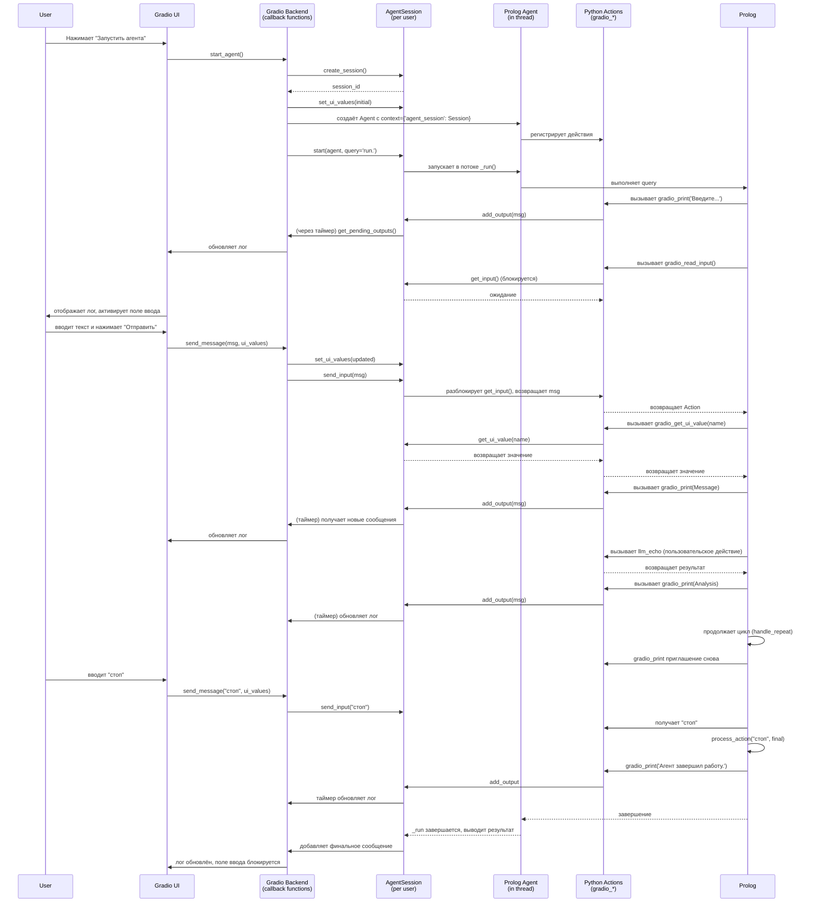
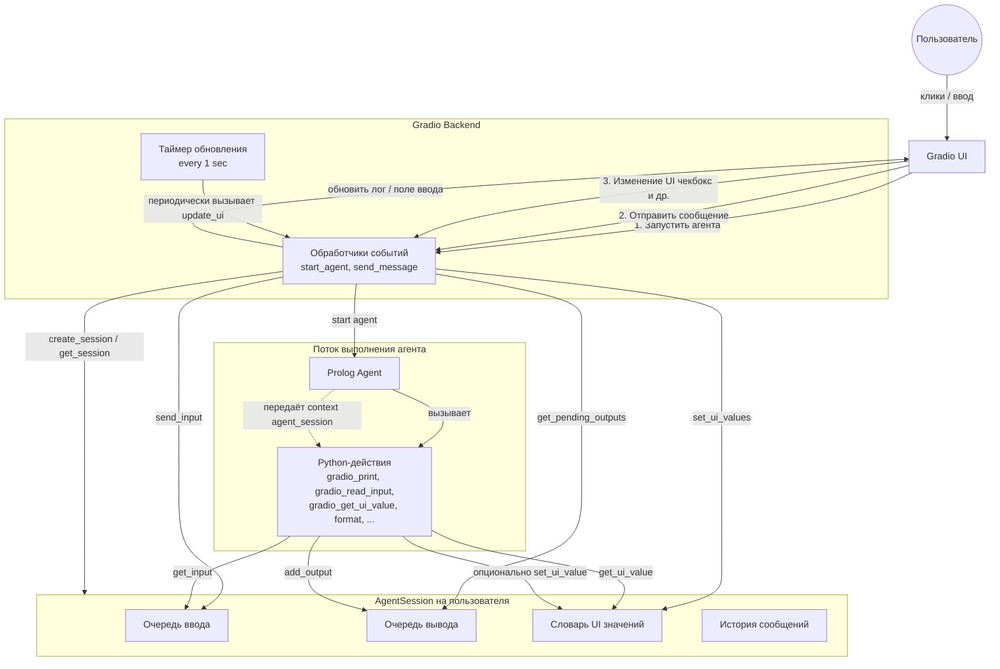

## 1. Введение

Данная инструкция описывает процесс создания интерактивных ИИ-агентов на основе фреймворка **PyAgentProlog**, который сочетает логическое программирование на Prolog с действиями на Python, и библиотеки **Gradio** для построения веб-интерфейса. Вы сможете создавать агентов, которые:

- выполняют Prolog-программы,
- взаимодействуют с пользователем через веб-интерфейс,
- могут читать значения UI-компонентов (чекбоксы, слайдеры, выпадающие списки) в реальном времени,
- выполняют Python-действия (вызов LLM, работа с API, обработка данных).

## 2. Необходимые компоненты

- Python 3.8 или выше
- Фреймворк **PyAgentProlog** (доступен по ссылке или как локальный пакет)
- Библиотека **Gradio** (устанавливается через pip)
- Знание основ Prolog и Python

## 3. Установка

### 3.1. Установка PyAgentProlog

Скопируйте папку с фреймворком proagent в ваш проект или установите через pip (если пакет опубликован). Убедитесь, что в вашем проекте есть возможность импортировать модули `prolog.agent` и `prolog.proagent_gradio`.

### 3.2. Установка Gradio

```bash
pip install gradio
```

## 4. Структура инструментария `proagent_gradio`

Модуль `proagent_gradio.py` предоставляет:

- **Класс `AgentSession`** – управляет сессией агента: очереди ввода/вывода, флаги состояния, значения UI-компонентов. Каждый пользователь (открытая вкладка браузера) получает свой экземпляр сессии.
- **Глобальный реестр сессий** – функции `create_session()`, `get_session()`, `remove_session()` для хранения сессий по уникальному идентификатору.
- **Встроенные действия**:
  - `gradio_print/1` – выводит сообщение в лог интерфейса.
  - `gradio_read_input/1` – ожидает ввод от пользователя (блокируется до отправки).
  - `gradio_get_ui_value/2` – получает текущее значение UI-компонента по имени.
  - `gradio_set_ui_value/2` – устанавливает значение в словаре сессии (опционально).
  - `format/3` – форматирует строку по шаблону Prolog (поддерживает `~w`, `~d`, `~f`, `~s`).





## 5. Создание агента: пошаговый пример

### 5.1. Определение Prolog-программы

Создайте Prolog-программу, которая будет управлять поведением агента. Используйте встроенные предикаты для взаимодействия с интерфейсом.

```prolog
:- dynamic state/2.

init :- set_state(state(phase, loop)).

step :-
    state(phase, Phase),
    handle_phase(Phase, NextPhase),
    set_state(state(phase, NextPhase)),
    continue(NextPhase).

continue(final) :- !.
continue(_) :- step.

handle_phase(loop, NextPhase) :-
    gradio_print('Введите действие (или "стоп" для выхода):'),
    gradio_read_input(Action),
    process_action(Action, NextPhase).

process_action("стоп", final) :- !.
process_action(Action, loop) :-
    gradio_get_ui_value('repeat_check', Repeat),
    gradio_get_ui_value('mode_select', Mode),
    gradio_get_ui_value('volume_slider', Volume),
    format('Режим: ~w, Громкость: ~w, Повтор: ~w', [Mode, Volume, Repeat], Message),
    gradio_print(Message),
    gradio_print('Обращаюсь к LLM для анализа...'),
    llm_echo(Action, Analysis),
    gradio_print('LLM ответила:'),
    gradio_print(Analysis),
    handle_repeat(Repeat, Analysis).

handle_repeat("true", Analysis) :-
    gradio_print('(Повтор включён, дублирую)'),
    gradio_print(Analysis),
    !.
handle_repeat(_, _).

handle_phase(final, final) :-
    gradio_print('Агент завершил работу.').

run :- init, step.
```

### 5.2. Определение Python-действий

Создайте Python-функции для действий, которые не входят в стандартный набор. Используйте декораторы `@simple_action`, `@effector_action` или `@generator_action`.

```python
from prolog.agent import simple_action

@simple_action('llm_echo', 2, output_arg=1)
def llm_echo(prompt, context):
    """Имитация вызова LLM."""
    return f"Эхо: {prompt}"
```

### 5.3. Построение интерфейса Gradio

Используйте класс `AgentSession` и готовые действия для создания интерфейса. Ниже приведён полный пример.

```python
import sys
import gradio as gr
from prolog.agent import Agent, simple_action
from prolog.proagent_gradio import (
    create_session, get_session,
    gradio_print, gradio_read_input, gradio_get_ui_value,
    format_action
)

# Prolog-программа (из предыдущего шага)
AGENT_PROGRAM = """
... (ваша программа) ...
"""

# Пользовательское действие
@simple_action('llm_echo', 2, output_arg=1)
def llm_echo(prompt, context):
    return f"Эхо: {prompt}"

def create_interface():
    with gr.Blocks(title="Мой Prolog-агент") as demo:
        gr.Markdown("# Интерактивный агент на Prolog")

        # Основной лог
        log = gr.Textbox(label="Диалог", lines=20, interactive=False, autoscroll=True)

        # Панель настроек
        with gr.Row():
            with gr.Column(scale=1):
                gr.Markdown("### Настройки")
                repeat_check = gr.Checkbox(label="Повторять ответ", value=False)
                mode_select = gr.Dropdown(choices=["ласковый", "грубый", "нейтральный"],
                                          label="Режим", value="нейтральный")
                volume_slider = gr.Slider(minimum=0, maximum=10, step=1,
                                          label="Громкость", value=5)

        # Панель управления
        with gr.Row():
            start_btn = gr.Button("Запустить агента", variant="primary")
            user_input = gr.Textbox(label="Ввод", placeholder="Введите сообщение...", interactive=False)
            send_btn = gr.Button("Отправить", interactive=False, variant="secondary")

        # Состояние сессии (хранится ID)
        session_id_state = gr.State()
        timer = gr.Number(value=0, visible=False, every=1)

        # Функции обратного вызова
        def start_agent(session_id, repeat, mode, volume):
            if session_id:
                session = get_session(session_id)
                if session and session.running:
                    return session_id, gr.update(), gr.update()

            # Создаём новую сессию
            session_id = create_session()
            session = get_session(session_id)
            session.set_ui_value('repeat_check', repeat)
            session.set_ui_value('mode_select', mode)
            session.set_ui_value('volume_slider', volume)

            # Создаём агента и передаём ему сессию в контекст
            agent = Agent(AGENT_PROGRAM, context={'agent_session': session})
            agent.register_action(gradio_print)
            agent.register_action(gradio_read_input)
            agent.register_action(gradio_get_ui_value)
            agent.register_action(format_action)
            agent.register_action_module(sys.modules[__name__])  # регистрируем llm_echo

            # Запускаем агента
            session.start(agent, query="run.")
            return session_id, gr.update(interactive=False), gr.update(interactive=False)

        def send_message(session_id, msg, repeat, mode, volume):
            if not session_id:
                return session_id, "", gr.update()
            session = get_session(session_id)
            if session:
                # Обновляем значения UI перед отправкой
                session.set_ui_value('repeat_check', repeat)
                session.set_ui_value('mode_select', mode)
                session.set_ui_value('volume_slider', volume)
                if session.waiting:
                    session.send_input(msg)
                    return session_id, "", gr.update(interactive=False)
            return session_id, "", gr.update()

        def update_ui(session_id, repeat, mode, volume):
            if not session_id:
                return "", gr.update(interactive=False), gr.update(interactive=False)
            session = get_session(session_id)
            if session is None:
                return "", gr.update(interactive=False), gr.update(interactive=False)

            # Обновляем значения в сессии (на случай, если они изменились через таймер)
            session.set_ui_value('repeat_check', repeat)
            session.set_ui_value('mode_select', mode)
            session.set_ui_value('volume_slider', volume)

            # Получаем новые сообщения из очереди вывода
            new_msgs = session.get_pending_outputs()
            if new_msgs:
                session.history.extend(new_msgs)

            log_text = "\n".join(session.history)
            input_interactive = session.waiting and session.running
            send_interactive = input_interactive

            return log_text, gr.update(interactive=input_interactive), gr.update(interactive=send_interactive)

        # Привязка событий
        start_btn.click(
            start_agent,
            inputs=[session_id_state, repeat_check, mode_select, volume_slider],
            outputs=[session_id_state, user_input, send_btn]
        ).then(
            update_ui,
            inputs=[session_id_state, repeat_check, mode_select, volume_slider],
            outputs=[log, user_input, send_btn]
        )

        send_btn.click(
            send_message,
            inputs=[session_id_state, user_input, repeat_check, mode_select, volume_slider],
            outputs=[session_id_state, user_input, send_btn]
        ).then(
            update_ui,
            inputs=[session_id_state, repeat_check, mode_select, volume_slider],
            outputs=[log, user_input, send_btn]
        )

        timer.change(
            update_ui,
            inputs=[session_id_state, repeat_check, mode_select, volume_slider],
            outputs=[log, user_input, send_btn]
        )

        # Очистка при загрузке страницы
        demo.load(
            lambda: (None, "", gr.update(interactive=False), gr.update(interactive=False)),
            inputs=[],
            outputs=[session_id_state, log, user_input, send_btn]
        )

    return demo

if __name__ == "__main__":
    demo = create_interface()
    demo.launch(inbrowser=True, debug=True)
```

### 5.4. Запуск и тестирование

1. Сохраните скрипт, например `my_agent.py`.
2. Запустите его: `python my_agent.py`.
3. Откройте браузер по адресу `http://127.0.0.1:7860`.
4. Нажмите **Запустить агента**.
5. Вводите текст в поле и нажимайте **Отправить**. Наблюдайте, как агент отвечает с учётом настроек.
6. Изменяйте чекбокс, режим и громкость – агент будет использовать новые значения в следующем ответе.
7. Для завершения введите "стоп".

## 6. Расширение функциональности

### 6.1. Добавление новых действий

Создавайте свои действия с помощью декораторов:

```python
from prolog.agent import simple_action, effector_action

@simple_action('my_calc', 3, output_arg=2)
def my_calc(a, b, context):
    return a + b

@effector_action('log_to_file', 1)
def log_to_file(text, context):
    with open('log.txt', 'a') as f:
        f.write(text + '\n')
```

Зарегистрируйте их в агенте:

```python
agent.register_action(my_calc)
agent.register_action(log_to_file)
```

### 6.2. Работа с более сложными UI-компонентами

Вы можете регистрировать любые компоненты Gradio (radio, number, textbox, file и т.д.), передавая их в `session.set_ui_value()` по соответствующим именам. В Prolog-программе получайте значения через `gradio_get_ui_value/2`.

### 6.3. Многопользовательность

Каждая сессия изолирована благодаря глобальному реестру и использованию `gr.State` для хранения `session_id`. Не требуется дополнительных действий.

## 7. Отладка

- В консоли выводятся отладочные сообщения от действий (если они добавлены). Используйте `print` внутри действий для контроля.
- Проверяйте, что значения UI действительно устанавливаются в сессии перед отправкой ввода (см. функцию `send_message`).
- Убедитесь, что имена компонентов в Prolog-программе (`'repeat_check'`, `'mode_select'`, `'volume_slider'`) точно совпадают с ключами, используемыми в `session.set_ui_value()`.

## 8. Рекомендации

- **Имена компонентов**: используйте строки без кавычек в Python, но в Prolog они должны быть заключены в кавычки, так как передаются как атомы. В действии `gradio_get_ui_value` автоматически удаляются внешние кавычки.
- **Отсечения в Prolog**: чтобы избежать множественных решений и некорректного поведения, используйте отсечение (`!`) в нужных местах, особенно в обработчиках условий.
- **Завершение агента**: всегда предусматривайте возможность выхода (например, по команде "стоп"), чтобы агент не зависал в бесконечном цикле.

## 9. Заключение

Вы создали полноценного интерактивного агента, управляемого Prolog-программой и Python-действиями, с веб-интерфейсом на Gradio. Данный подход позволяет быстро прототипировать сложные логические системы с удобным пользовательским взаимодействием. Дальнейшее развитие может включать интеграцию с реальными LLM, базами данных, внешними API и т.д.